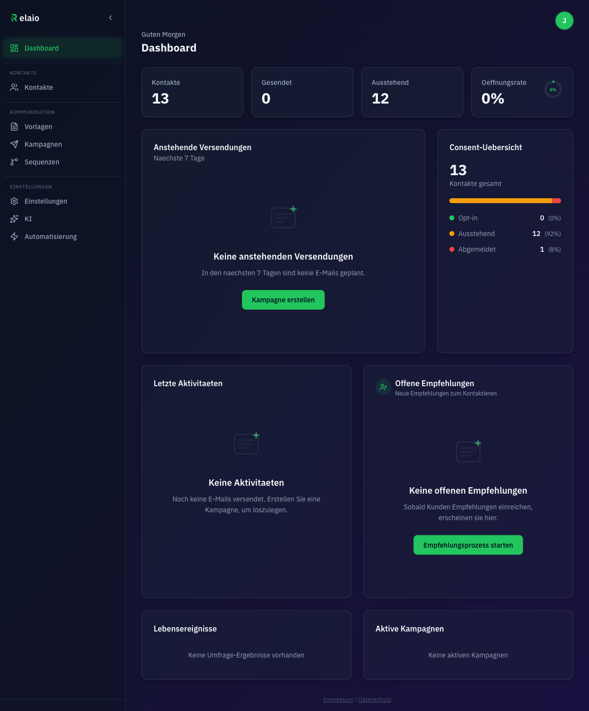
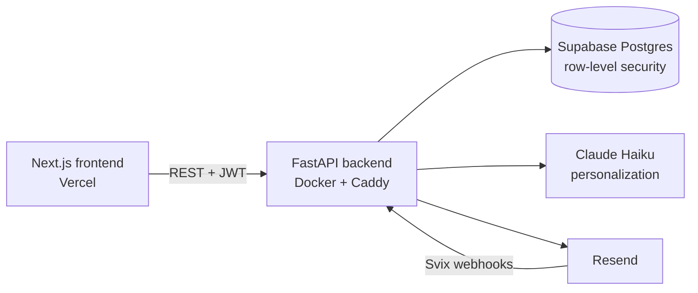
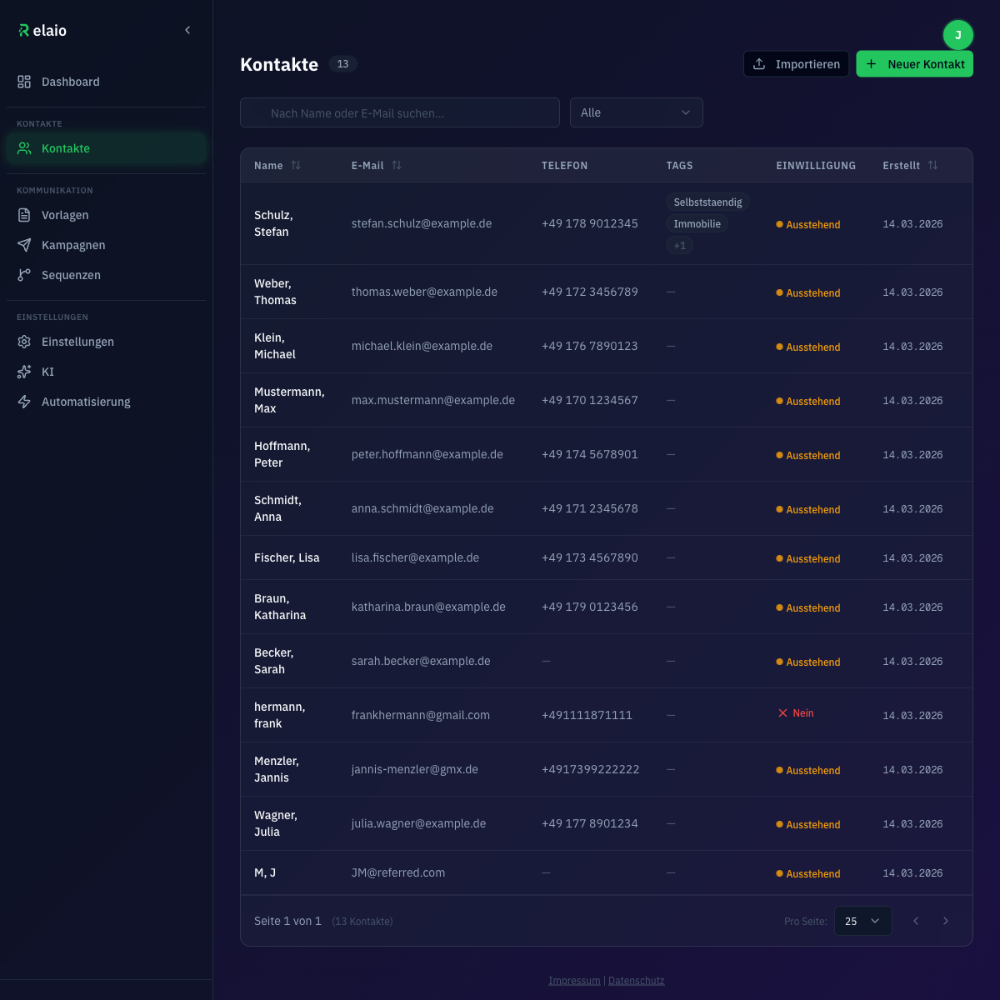

# Relaio

**After-sales email for insurance brokers, approved by the broker before anything is sent.**

[The problem](#the-problem) · [Design decisions](#design-decisions) · [Architecture](#architecture) · [Features](#features) · [Stack](#stack)

After-sales email automation for German insurance brokers: birthday and holiday mails, service reminders, referral and review requests and multi-step sequences, with consent tracking built in and every email approved by the broker before it goes out.

Solo project: frontend, backend, database and deployment.

> [!NOTE]
> The implementation is private. This repository is a case study: design decisions, architecture and screenshots.

## The problem

Solo brokers and small firms look after hundreds of existing customers. Staying in touch, asking for referrals and collecting reviews keeps those customers, but by hand it takes hours every week, so most brokers skip it. In Germany every automated email also needs provable consent.

## Design decisions

| Decision | Why |
|---|---|
| **Tenant isolation in the database.** Supabase row-level security scopes every query by `tenant_id` from the JWT's `app_metadata`; the backend also verifies the JWT | A backend bug cannot leak one broker's customers to another |
| **AI kept deliberately narrow.** One Claude Haiku call per email rewrites the broker's template with customer context and tone (formal "Sie" or informal "Du"); if the call fails, the original template is sent | The model personalises text and decides nothing else |
| **Broker approval before dispatch.** Emails are generated about a week ahead and wait in a review queue (approve, reject, edit, bulk actions) | The broker stays responsible for what is sent in their name |
| **Compliance as design.** Double opt-in with an audit trail, one-click unsubscribe, blacklist enforcement, EU-region database | Consent is checked before every send, not bolted on |
| **Delivery state from webhooks.** Resend events verified with Svix update each email's status | Sent, delivered, opened, clicked and bounced come from the provider, not guesses |
| **Sequences as data.** Send, wait, condition, follow-up steps with per-customer enrollment and pause/resume | Brokers build flows without code |

  

## Architecture

## Features

- **Automation:** triggers for birthdays, holidays, welcome mails, service appointments, referral and review requests.
- **Contacts:** CSV/Excel import with encoding detection and column mapping, tags, notes, consent status.
- **Campaigns:** one-off sends targeted by tags, life events or consent status.
- **Public pages:** opt-in confirmation, one-click unsubscribe, referral form, life-event survey.

More screenshots

 

## Stack

| Layer | Technology | Why |
|---|---|---|
| Frontend | Next.js, React, Tailwind, shadcn/ui | Fast dashboard development |
| Backend | FastAPI, Pydantic v2 | Typed API and validation |
| Database | Supabase Postgres with RLS | Tenant isolation enforced below the application |
| Email | Resend, Svix | Delivery webhooks with signature verification |
| AI | Claude Haiku | One narrow rewrite per email, not an agent |
| Hosting | Vercel (frontend), Docker + Caddy (backend) | Managed Next.js hosting; backend container with automatic TLS |
| CI | GitHub Actions: ruff, pytest, eslint, tsc, build | Lint, types and tests on every change |

---

  Built by <a href="https://github.com/jmenzler">Jannis Menzler</a>

